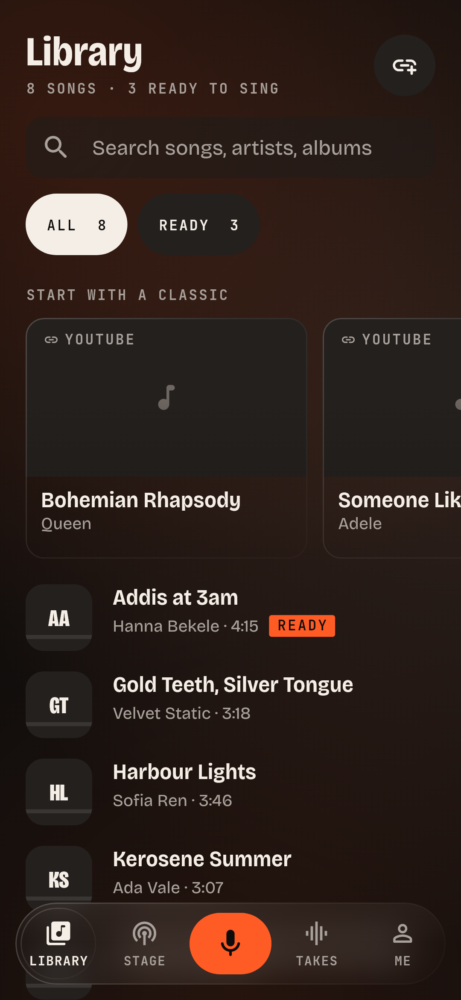
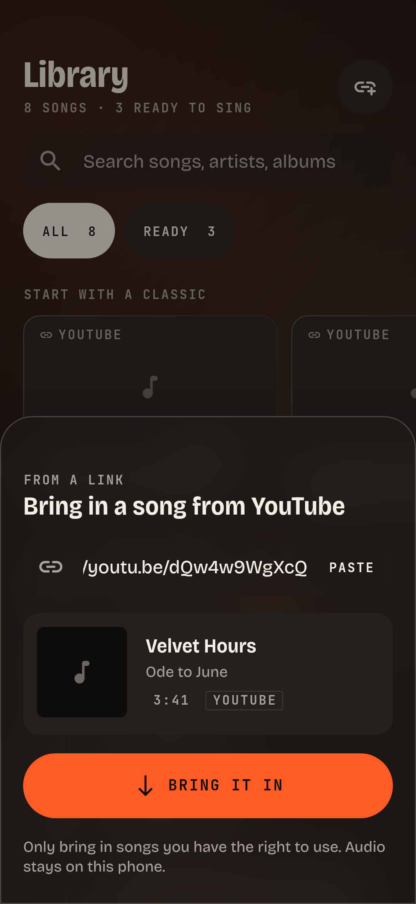
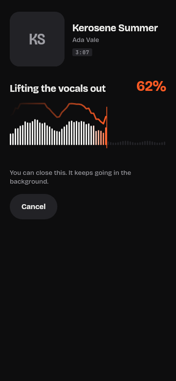
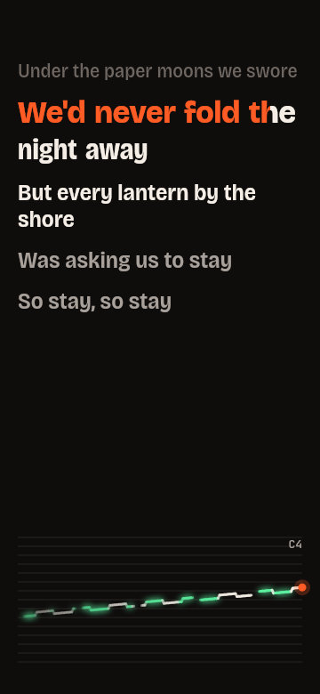
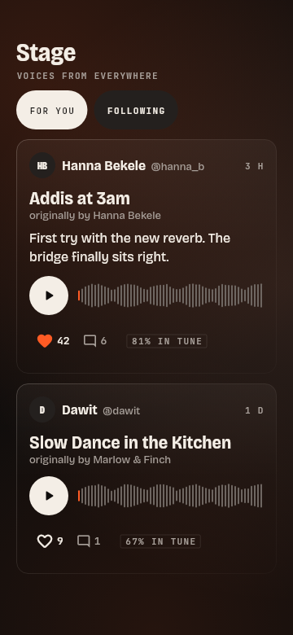

<p align="center"></p>

# Unsung

**Every song you own is a karaoke track.** Unsung finds the music already on your Android phone, lifts the vocals out, and lets you sing over the band with live lyrics and a pitch ribbon. Keep every take, polish the mix any time, and share the good ones on the Stage: private first, public when you're ready.

| Library | From a link | Unsinging | Studio | Stage |
|---|---|---|---|---|
|  |  |  |  |  |

Screenshots are rendered by CI from golden tests with the real fonts and demo data (invented songs and people).

## What it does

- **Your library** – reads every song on the device (MediaStore), with search, cover art, a "Ready" filter and an A–Z scrub.
- **From a YouTube link** – don't have the song? Paste a YouTube / YouTube Music link, or tap Share → Unsung in the YouTube app. Unsung fetches the audio (on your Studio server with yt-dlp when there is one, otherwise on the phone), and it joins your library ready to unsing.
- **Unsing it** – removes the lead vocal on the phone (*Quick*), or on an optional ML server (*Studio*, Demucs). You watch the voice lift off the waveform as it's removed.
- **Rehearse** – instrumental with a *vocal guide* fader (fade the original singer back in), key change ±6 semitones with tempo kept, synced lyrics from [LRCLIB](https://lrclib.net) or pasted by you, timing nudge.
- **Studio** – 3-2-1 count-in, record over the music, live "breathing" lyrics and a pitch ribbon that glows when you're centred on a note. Automatic sync estimate.
- **Takes** – non-destructive: the raw vocal is kept, so voice level, music level, reverb, echo and sync can be changed forever. In-tune and sung-time stats.
- **The Stage** – email-code sign-in, profiles with stats, For you / Following feed with in-place playback, likes, comments, follows. Shared takes start **private** (only you) and can go **public** later, and back.

## Run it

```bash
flutter pub get
flutter run                       # offline app: library, unsinging, rehearse, studio, takes
```

The Stage and Studio separation are optional and switched on at build time:

```bash
flutter run \
  --dart-define=SUPABASE_URL=https://<project>.supabase.co \
  --dart-define=SUPABASE_ANON_KEY=<anon or publishable key> \
  --dart-define=SEPARATION_API_URL=https://<your separation server>
```

- Backend setup: [`docs/backend.md`](docs/backend.md) (Supabase schema with row-level security in `supabase/migrations`).
- Separation server: [`server/README.md`](server/README.md).

CI (`.github/workflows/build-apk.yml`) runs format, analyze, tests and golden screenshots, builds a release APK and uploads it as the `unsung-apk` artifact. Set the three values above as repository secrets to bake them into CI builds. Tag `v*` to attach the APK to a GitHub Release.

## Architecture

Feature-first Flutter app (`lib/features/<feature>/{domain,data,presentation}`) with a thin `lib/core` (theme tokens, router, platform channels, shared widgets). Riverpod for state and dependency injection, go_router for navigation. Audio heavy lifting happens natively in Kotlin (`android/app/src/main/kotlin/.../audio`): MediaCodec decoding/encoding, centre-channel vocal removal, a mixer with reverb/echo and Sonic pitch shifting, all streamed so memory stays flat. Pitch tracking (YIN) runs in Dart on the live mic stream. Design tokens (colour, type, spacing, motion) live in `lib/core/theme` as `ThemeExtension`s; see `docs/design-brief.md` for the direction.

## Honest limits

- Quick vocal removal relies on the voice being mixed to the centre. Mono songs can't be done on the phone; near-mono mixes leak some voice (the app tells you). Studio mode on a server is much cleaner.
- "In tune" means centred on a note of the scale, not matched to the original melody.
- Android only for now. iOS needs its own audio engine.
- Users are responsible for having the rights to the songs they process and share. That includes songs brought in from links: downloading from YouTube is against YouTube's terms unless you have the rights, which is why Unsung never re-shares imported audio and keeps it on the phone.
- YouTube changes often. On-device fetching (youtube_explode_dart) can break between app updates; the Studio server's yt-dlp is updated far more often and is the reliable path. Rebuild the server image regularly.

## Fonts

Bricolage Grotesque and JetBrains Mono, both SIL Open Font License 1.1 (`assets/fonts`).
